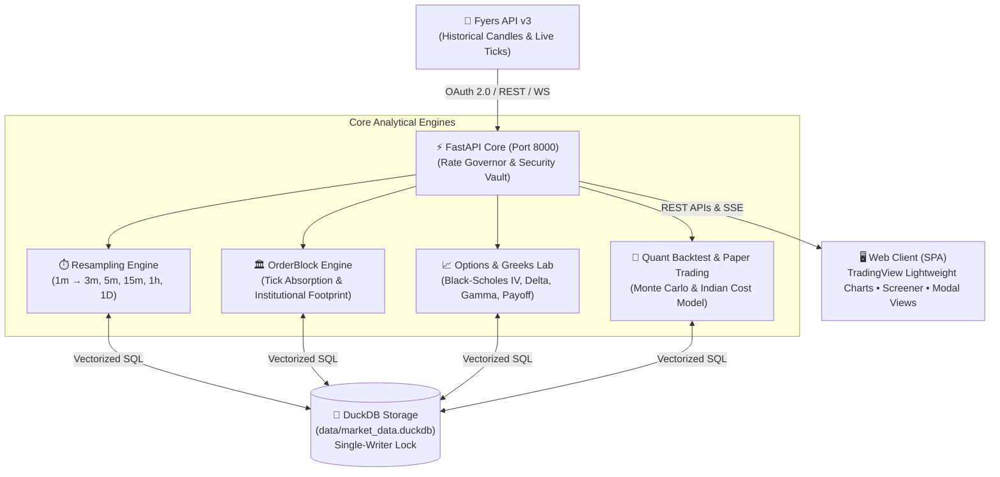

# ⚡ NSE Quant Platform

> **Institutional-Grade, Local-First Quantitative Trading & Equity Research Workstation for the National Stock Exchange of India (NSE).**

[](https://python.org)
[](https://fastapi.tiangolo.com)
[](https://duckdb.org)
[](https://tradingview.github.io/lightweight-charts/)
[-orange.svg)]()

---

## 🗺️ System Architecture (Visual Flow)



---

## 📋 Prerequisites for a Fresh Machine

Before setting up on a new PC or laptop, ensure you have:

| Tool / Requirement | Version / Specification | Setup Note |
|---|---|---|
| **Python** | `3.11.x` or `3.12.x` ([python.org](https://www.python.org/downloads/)) | ⚠️ **Must check `☑ Add python.exe to PATH`** during installation. |
| **Git for Windows** | Latest ([git-scm.com](https://git-scm.com/download/win)) | Default installation settings. |
| **Fyers Trading Account** | Active Account ([fyers.in](https://fyers.in)) | Free API access for market data & history. |

---

## 🔑 Fyers Developer Portal App Setup

To connect to live market data, create a free API App on the Fyers Developer Portal:

1. Log in to [myapi.fyers.in](https://myapi.fyers.in/).
2. Click **"Create App"** and configure:
   * **App Name**: `NSE Quant Platform`
   * **Redirect URI**: `https://127.0.0.1:5000/` *(Must match exactly, including https and trailing slash)*
   * **App Type**: `100` (Personal / Web)
   * **Permissions**: `Read / Market Data / History`
3. Note down your credentials:
   * **App ID / Client ID** (e.g. `ABCD1234EF-100`)
   * **App Secret Key**
   * **4-Digit Trading PIN**

---

## 🚀 Setup & Launch on a New Machine (Step-by-Step)

Follow these steps to clone and run the application from scratch:

### 1. Clone Repository & Navigate
Open **PowerShell** (or Windows Terminal):
```powershell
git clone <YOUR_REPOSITORY_URL>
cd trading-app
```

### 2. Run Automated Windows Setup
Run the automated setup script *(creates `.venv`, installs requirements, creates storage folders, and initializes DuckDB)*:
```powershell
powershell -ExecutionPolicy Bypass -File setup_windows.ps1
```

> [!TIP]
> If PowerShell blocks scripts, run this command once:
> `Set-ExecutionPolicy -Scope CurrentUser -ExecutionPolicy RemoteSigned -Force`

### 3. Configure App ID in `.env`
Open `.env` in Notepad and insert your Fyers App ID:
```powershell
notepad .env
```
Update line 1 with your ID:
```env
FYERS_APP_ID=YOUR_APP_ID-100
```
*(Do NOT put your secret key in `.env` — secrets are safely stored in your encrypted local vault / OS Keyring)*.

### 4. Authenticate with Fyers (One-Time Interactive Login)
```powershell
.\.venv\Scripts\python.exe -m scripts.auth_cli --login
```
* Your browser will automatically open the Fyers login page.
* Login with your Mobile Number, OTP, and 4-digit PIN.
* You will be redirected to `https://127.0.0.1:5000/?s=ok&auth_code=...`.
* Copy the `auth_code` from the browser address bar, paste it into PowerShell, and press **Enter**.
* *(Your 15-day refresh token is now safely saved!)*

### 5. Download Initial Symbols & Trading Calendar
Populate your local DuckDB database with the NSE symbol master, Nifty constituents, and exchange holidays (~20 seconds):
```powershell
.\.venv\Scripts\python.exe -m scripts.sync_symbols
```

### 6. Launch Application Server
Double-click [start_server.bat](file:///d:/trading-app/start_server.bat) in File Explorer, or run in PowerShell:
```powershell
.\start_server.bat
```
Open your browser at: **`http://localhost:8000`**

---

## 💎 Core Features Matrix

| Feature | Mode | Visual Capabilities |
|---|:---:|---|
| **📈 Interactive Charting** | Pro / Simple | **TradingView Lightweight Charts** with real-time 1m–1D resampling, volume profile overlays, and indicators (RSI, EMA, MACD). |
| **🏛️ OrderBlock Suite** | Institutional | **Absorption Footprint**: Identifies liquidity absorption pools, conviction scores (0–100), and detailed stock profile modals. |
| **🔍 In-Database Screener** | SQL-Powered | **Sub-Second Scans**: Vectorized DuckDB queries across 2,000+ NSE stocks by volume surge, momentum, and custom formulas. |
| **⚡ Options & Greeks Lab** | Derivatives | **Black-Scholes Engine**: Live IV, Greeks (Δ, Γ, Θ, ν), multi-leg strategy payoff visualizer, and Open Interest (OI) analysis. |
| **🧪 Backtesting Studio** | Quantitative | **Strategy Lab**: Parameter optimization grids, walk-forward simulations, and risk metrics (Sharpe, Sortino, Max Drawdown). |
| **📝 Paper Trading Dock** | Zero-Risk | **Realistic Simulation**: Live virtual order fills incorporating Indian STT, exchange charges, GST, SEBI turnover fees, and execution slippage. |
| **📓 Trade Journal** | Analytics | **Behavioral Insights**: Interactive calendar heatmap, tradebook CSV imports, risk-reward R-multiple tracking, and emotional bias audits. |

---

## ⚙️ Technology Stack

```
┌────────────────────────────────────────────────────────────────────────┐
│ FRONTEND      Vanilla JS (ES6+) • HTML5 Canvas • Lightweight Charts    │
├────────────────────────────────────────────────────────────────────────┤
│ BACKEND       Python 3.11+ • FastAPI • Uvicorn (Strictly workers=1)    │
├────────────────────────────────────────────────────────────────────────┤
│ DATABASE      DuckDB (In-Process Vectorized OLAP) • Zero external DB   │
├────────────────────────────────────────────────────────────────────────┤
│ BROKER API    Fyers API v3 (Official NSE Equity & Derivatives Data)    │
├────────────────────────────────────────────────────────────────────────┤
│ SECURITY      OS Keyring • AES-256 Encrypted Vault (.vault.enc)        │
└────────────────────────────────────────────────────────────────────────┘
```

---

## 📂 Project Directory Structure

```text
trading-app/
├── api/             # FastAPI REST controllers (/candles, /orderblock, /screener, /options, ...)
├── config/          # Central configuration, constants & Indian market trading hours
├── core/            # Canonical contracts, abstract interfaces & domain exceptions
├── db/              # DuckDB connection manager, schema migrations & table models
├── services/        # Analytical business logic (Resampling, OrderBlock, Greeks, Backtest)
├── static/          # Modern Web UI (index.html, theme.css, JS modules & chart visualizers)
├── scripts/         # Automated CLI utilities (auth_cli.py, sync_symbols.py, run_daily_sync.py)
├── data/            # DuckDB database file, encrypted vault, caches & symbol master
├── tests/           # Regression test suite (Unit, Integration & Contract tests)
├── main.py          # Application entry point & FastAPI factory
├── start_server.bat # One-click server launcher
└── stop_server.bat  # Graceful server shutdown utility
```

---

## 🔄 Recommended Daily Workflow

| Time (IST) | Action | Command |
|---|---|---|
| **08:45 AM** | Synchronize active symbols & holidays | `.\.venv\Scripts\python.exe -m scripts.sync_symbols` |
| **09:15 AM - 03:30 PM** | Live research, screening & paper trading | Run `start_server.bat` $\rightarrow$ `http://localhost:8000` |
| **03:45 PM** | Incremental daily EOD sync | `.\.venv\Scripts\python.exe -m scripts.run_daily_sync` |
| **Every 15 Days** | Renew Fyers 15-day OAuth session | `.\.venv\Scripts\python.exe -m scripts.auth_cli --login` |

---

## 🔧 Quick Troubleshooting & Common Gotchas

* **DuckDB Lock Error (`Resource temporarily unavailable`)**:  
  DuckDB is single-writer. Always run Uvicorn with `--workers 1`. If an old background process is holding the file lock, stop it with:
  ```powershell
  Get-Process python -ErrorAction SilentlyContinue | Stop-Process -Force
  ```
* **Port 8000 in use (`Errno 10048`)**:  
  An existing server instance is already running. Run `stop_server.bat` or kill the process on port 8000:
  ```powershell
  Get-Process -Id (Get-NetTCPConnection -LocalPort 8000).OwningProcess | Stop-Process -Force
  ```
* **"This site can't be reached" after Fyers login**:  
  **Normal & expected behavior!** Fyers redirects to `https://127.0.0.1:5000/`. Simply copy the URL from your browser address bar (containing `auth_code=...`) and paste it into PowerShell.

---

## 🛡️ Safety & Regulatory Compliance

* 🔐 **Zero Plaintext Secrets**: Credentials never enter code or git; stored in OS Keyring or AES-256 local vault (`data/.vault.enc`).
* 📜 **SEBI Research Compliance**: Strictly an educational & analytical workstation. Every chart and export embeds statutory **"Not Investment Advice"** disclosures.
* 🚫 **Safety Circuit Breaker**: Automated order execution routing is permanently disabled (`HTTP 403 Forbidden`).

---

## 📚 Further Reading

* 📖 [Full Features Catalog & Operational Manual](FEATURES.md)
* 🧭 [Master Architecture & Phase Execution Runbook](AGENT_RUNBOOK.md)
