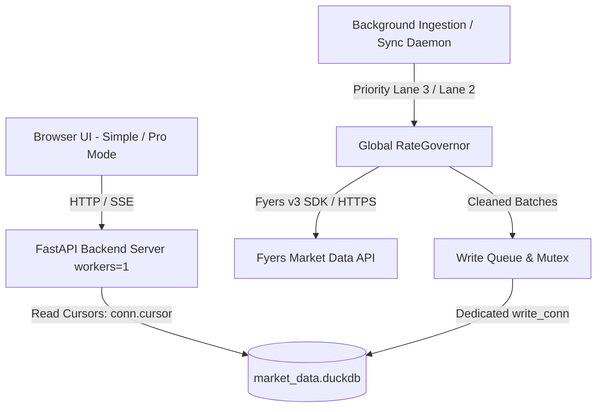

# Phase 00: Master Architecture & Quantitative Engineering Principles

```yaml
EXECUTION_CONTRACT:
  depends_on: []
  reads:
    - "plan/00A_CONTRACTS_AND_CONVENTIONS.md#1-canonical-interface-registry"
    - "plan/00A_CONTRACTS_AND_CONVENTIONS.md#2-canonical-timeframe-list"
    - "plan/00A_CONTRACTS_AND_CONVENTIONS.md#7-global-rategovernor-specification"
    - "plan/00A_CONTRACTS_AND_CONVENTIONS.md#8-process--concurrency-architecture"
  produces:
    - "core/__init__.py"
    - "core/interfaces.py"
    - "core/exceptions.py"
    - "config/constants.py"
  exposes:
    - "IAuthService"
    - "IMarketDataProvider"
    - "ISymbolRepository"
    - "ICandleReader"
    - "ICandleWriter"
    - "ICheckpointRepository"
    - "ICorporateActionRepository"
    - "IResamplingService"
    - "IIndicator"
    - "IDataExporter"
    - "ICandleService"
    - "IScreenerService"
    - "IAlertService"
    - "IBacktestEngine"
    - "IJournalService"
  must_not_modify:
    - "plan/*"
    - "data/*"
  test_plan:
    unit_tests: "tests/unit/test_core_interfaces.py"
    integration_tests: "tests/integration/test_architecture_wiring.py"
    contract_tests: "tests/contract/test_canonical_registry.py"
    fixtures: "tests/fixtures/sample_candles.json"
    command: "pytest tests/unit/test_core_interfaces.py tests/contract/test_canonical_registry.py -v"
  definition_of_done:
    - item: 1
      command: "python -c 'import core.interfaces as ci; assert hasattr(ci, \"ICandleReader\") and hasattr(ci, \"IBacktestEngine\")'"
      result: "Exits with code 0 and zero assertion errors."
    - item: 2
      command: "pytest tests/contract/test_canonical_registry.py"
      result: "All canonical interfaces and timeframes match 00A specifications exactly."
    - item: 3
      command: "python -c 'from config.constants import CANONICAL_TIMEFRAMES; assert len(CANONICAL_TIMEFRAMES) == 11'"
      result: "Returns exactly 11 canonical timeframes (1m, 3m, 5m, 10m, 15m, 30m, 1h, 2h, 4h, 1D, 1W)."
  failure_modes_and_recovery:
    - failure: "Interface signature drift from 00A"
      detection: "Contract test failure in test_canonical_registry.py"
      recovery: "Align signatures in core/interfaces.py strictly with 00A Section 1"
    - failure: "Circular import between core and services"
      detection: "ImportError or circular dependency during test collection"
      recovery: "Ensure core/ contains only abstract contracts, exceptions, and constants; no service implementations"
  handoff:
    - "Phase 00 interfaces and core directory structure established."
    - "Canonical contracts verified against 00A."
    - "Ready for Phase 01 authentication and settings implementation."
```

---

## 1. Objective & Scope
The objective of this master architecture is to establish the complete architectural foundation for an institutional-grade Quantitative Trading Data and Research Platform for Indian Equities (NSE). This document serves as the architectural contract for all subsequent implementation phases (01 through 19, and 99).

This document outlines:
- High-level system topology and single-process data flow.
- Core quantitative requirements (what a professional quant trader demands from this application).
- Strict enforcement of SOLID design principles across the codebase.
- Standardized directory and module organization spanning the entire application lifecycle.
- Concurrency and database access design resolving DuckDB single-writer constraints.
- Complete 20-phase quantitative engineering roadmap.

---

## 2. Quantitative Trader Requirements Analysis
A quantitative trader uses market data to formulate, backtest, screen, and deploy algorithmic trading strategies. Flawed or unverified data leads directly to financial loss ("Garbage In, Garbage Out"). The platform must satisfy the following criteria:

### 2.1. Data Fidelity & Corporate Actions
- **Adjusted vs. Unadjusted Data**: Stock splits and bonus issues create artificial price drops if unadjusted. The system maintains raw historical candles (`candles_1m_raw`, `candles_1d_raw`) while maintaining an official `corporate_actions` and `adjustment_factors` ledger. Resampling and backtesting engines query dynamically adjusted views (`candles_1m_adjusted`, `candles_1d_adjusted`) to eliminate survivorship and split distortions.
- **Timestamp Integrity**: NSE trading hours are strictly 09:15:00 to 15:30:00 IST (Indian Standard Time, UTC+05:30). All intraday timestamps are stored in UTC format (`03:45:00 UTC` market open) and normalized to IST session boundaries for aggregations and display.
- **Calendar & Trading Holiday Awareness**: Market is closed on weekends and exchange-notified holidays. Special sessions (e.g., Diwali Muhurat trading, typically 18:15 to 19:15 IST) must be accounted for without breaking standard daily bar logic.
- **Handling Data Holes**: If a stock does not trade during a 1-minute period (illiquid counter), the system must never invent fake candles (no forward-filling high/low/volume into raw storage). Zero-volume periods must be distinguishable from exchange server downtime.

### 2.2. Fast Interoperability with Data Science Ecosystems
- **Apache Parquet**: Required for zero-copy, highly compressed, rapid loading into Python (Pandas/Polars), R, or Julia.
- **CSV (Comma Separated Values)**: Universal compatibility with charting and backtesting engines.
- **Excel (.xlsx)**: Strictly capped at 1,048,575 data rows (+ 1 header row = 1,048,576 total rows) with explicit user warnings if truncated.
- **Direct Notebook Connectivity**: Local REST endpoints allow quantitative researchers to fetch historical slices directly into Jupyter notebooks:
  `df = pd.read_parquet("http://localhost:8000/api/v1/export?symbol=NSE:RELIANCE-EQ&timeframe=5m&format=parquet")`

### 2.3. Resampling & Feature Generation
- **Canonical Source of Truth**: The downloader stores only **1-minute (`1m`)** and **1-Day (`1D`)** bars.
- All intermediate resolutions (`3m`, `5m`, `10m`, `15m`, `30m`, `1h`, `2h`, `4h`, `1W`) are computed dynamically via SQL/vectorized algorithms from `1m` data.
- **Session Alignment**: The first 5-minute candle of the day must strictly span 09:15:00 to 09:19:59 IST (`03:45:00 to 03:49:59 UTC`). Standard clock alignment (09:10-09:15) is invalid for Indian equities and is prevented using DuckDB's `origin` parameter (`TIMESTAMP '2000-01-01 03:45:00'`).
- **Technical & Quant Features**: The engine computes:
  - Session VWAP (Volume Weighted Average Price) with daily session reset at 09:15:00 IST.
  - Log Returns and Percentage Returns.
  - Volatility metrics (Average True Range, Rolling Standard Deviation, Bollinger Bands).
  - Momentum Indicators (RSI, MACD) and Volume Z-Scores.

### 2.4. Universe & Liquidity Filtering
- Downloading 2,000+ NSE equity tickers blindly wastes rate limits on defunct or illiquid penny stocks.
- The system enforces exact tier arithmetic derived from official NSE index constituent files:
  - **Tier 1 (Nifty 100)**: Nifty 50 (50) + Nifty Next 50 (50) = 100 stocks.
  - **Tier 2 (Midcap 150)**: Nifty Midcap 150 = 150 stocks.
  - **Tier 3 (Smallcap 250)**: Nifty Smallcap 250 = 250 stocks.
  - **Total Tiers 1-3**: Exactly Nifty 500 ($100 + 150 + 250 = 500$ stocks).
  - **Tier 4 (Broad Tail)**: All remaining active non-Nifty-500 NSE equities (~1,500+ stocks).

---

## 3. SOLID Principles Enforcement Guidelines
All code generated across phases 01 to 19 must strictly adhere to object-oriented and clean architectural principles:

### 3.1. Single Responsibility Principle (SRP)
- Each class or module has one, and only one, reason to change.
- `IAuthService` handles authentication and token caching only; it does not make market data requests.
- `DuckDBConnectionManager` handles database connection lifecycles and concurrency locks only; it does not construct business queries.
- `RateGovernor` coordinates token buckets and rate limits; it does not format HTTP responses.
- `IResamplingService` transforms time-series data; it knows nothing about HTTP protocols or UI charts.

### 3.2. Open/Closed Principle (OCP)
- Core classes are open for extension but closed for modification.
- Data export formats (Excel, CSV, Parquet) are implemented via the `IDataExporter` interface. Adding a new export format requires creating a new subclass without altering existing exporter code.
- Resampling indicators implement the `IIndicator` interface so new indicators (e.g. SuperTrend, Ichimoku) can be plugged in seamlessly.

### 3.3. Liskov Substitution Principle (LSP)
- Derived classes must be fully substitutable for their base abstractions.
- If a mock downloader or alternate broker provider is passed to the ingestion worker via the `IMarketDataProvider` interface, the system behaves identically without breaking downstream code.

### 3.4. Interface Segregation Principle (ISP)
- Clients must not be forced to depend on interfaces they do not use.
- Narrow, focused contracts:
  - `ISymbolRepository`: methods for searching and listing symbols.
  - `ICandleReader`: methods for querying read-only candle intervals.
  - `ICandleWriter`: methods for batch inserting and checkpointing.
  Chart endpoints depend strictly on `ICandleReader`, never on `ICandleWriter`.

### 3.5. Dependency Inversion Principle (DIP)
- High-level policy modules must not depend on low-level detail modules. Both depend on abstractions (`core/interfaces.py`).
- FastAPI route handlers inject abstract services (`ICandleService`, `IAuthService`), never concrete classes or raw database connections directly.

---

## 4. System Topology & Process Concurrency Design

### 4.1. DuckDB Concurrency Constraint
DuckDB operates as an embedded columnar database. While multiple threads can read concurrently from a single DuckDB connection, **only one writer is allowed per database file**. Attempting to write from multiple processes triggers unrecoverable file locks (`IOException: Could not set lock on file`).

### 4.2. Single-Process Architecture
To eliminate lock contention and achieve sub-millisecond query performance:
- The **FastAPI Backend Server**, **RateGovernor**, **Background Downloader Engine**, and **Scheduler** run within the **SAME Python process**.
- Server execution is pinned to `workers=1` (multi-worker uvicorn is prohibited).
- **Decoupled Concurrency Pattern**:
  - Ingestion writes are queued and executed via a dedicated `write_connection` protected by an asynchronous write lock. Writes occur in compact batches (< 100ms duration).
  - API read endpoints acquire lightweight read-only cursors (`conn.cursor()`) that do **NOT** acquire the write lock.
  - As a result, frontend chart queries and screener scans execute concurrently and never hang during background ingestion.



---

## 5. Directory & Package Layout

```
d:/trading-app/
├── plan/                              # Phased architectural blueprints (00 to 19, 99)
│   ├── 00A_CONTRACTS_AND_CONVENTIONS.md
│   ├── VERIFICATION_REPORT.md
│   ├── OPEN_QUESTIONS.md
│   ├── IMPLEMENTATION_ORDER.md
│   ├── HANDOFF.md
│   ├── CHANGELOG.md
│   └── _work/                         # Internal scratch & audit reports (ignored by coders)
├── config/                            # Environment settings and application constants
│   ├── __init__.py
│   ├── settings.py                    # Pydantic Settings (.env validator)
│   └── constants.py                   # Market hours, NSE holidays, canonical timeframes
├── core/                              # Interfaces, exceptions, and base classes
│   ├── __init__.py
│   ├── exceptions.py                  # Domain exception hierarchy
│   ├── interfaces.py                  # Canonical interfaces (00A registry)
│   └── rate_governor.py               # Shared RateGovernor singleton
├── db/                                # DuckDB connection management and schemas
│   ├── __init__.py
│   ├── connection.py                  # Single-writer connection & read-cursor manager
│   ├── migrations.py                  # Versioned DDL migrations runner
│   └── repositories/                  # Repositories for symbols, candles, checkpoints
├── services/                          # Business logic services
│   ├── auth_service.py                # Fyers OAuth2 & Keyring Token Manager
│   ├── symbol_service.py              # Symbol master parser & universe classifier
│   ├── downloader_service.py          # Chunking, backoff, and checkpointing engine
│   ├── resampling_service.py          # In-database session-aligned resampling
│   ├── indicator_service.py           # Technical & quant feature calculations
│   ├── screener_service.py            # Multi-factor screener engine
│   ├── alert_service.py               # Alert rules evaluator & notifier
│   ├── backtest_service.py            # Indian-cost event-driven backtesting engine
│   ├── corporate_actions_service.py   # Corporate action ingestion & adjustment engine
│   ├── options_service.py             # EOD option-chain collector & Greeks engine
│   ├── journal_service.py             # Trade journal & paper trading engine
│   ├── export_service.py              # Parquet, CSV, Excel export generators
│   └── scheduler_service.py           # Daily incremental EOD sync scheduler
├── api/                               # FastAPI routing and controllers
│   ├── __init__.py
│   ├── v1/
│   │   ├── auth.py                    # Token status & re-auth endpoints
│   │   ├── symbols.py                 # Symbol search and metadata endpoints
│   │   ├── candles.py                 # Resampled OHLCV & indicator query endpoints
│   │   ├── screener.py                # Screener execution endpoints
│   │   ├── alerts.py                  # Watchlist & alert management endpoints
│   │   ├── backtest.py                # Backtesting execution & report endpoints
│   │   ├── options.py                 # Option-chain & Greeks endpoints
│   │   ├── journal.py                 # Trade journal & paper-trading endpoints
│   │   ├── export.py                  # File download endpoints (Parquet/CSV/XLSX)
│   │   └── system.py                  # Downloader status, SSE telemetry, controls
│   └── server.py                      # FastAPI app entry point
├── static/                            # Frontend assets
│   ├── index.html                     # Simple / Pro UI shell
│   ├── css/                           # Styling (Dark theme, glassmorphism, responsive)
│   └── js/                            # Lightweight charts, screener, alerts, backtest UI
├── data/                              # Local storage directory
│   ├── market_data.duckdb             # Single-file persistent DuckDB database
│   └── exports/                       # Temporary scratch folder for generated downloads
├── tests/                             # Layered Pytest suite
│   ├── unit/                          # Pure algorithmic unit tests
│   ├── integration/                   # Service and repository wiring tests
│   ├── contract/                      # Interface and API envelope contract tests
│   └── fixtures/                      # Golden recorded broker payloads
├── .env.example                       # Template for API keys
├── requirements.txt                   # Production dependencies
└── main.py                            # Unified application launcher (workers=1)
```

---

## 6. Comprehensive Phased Execution Roadmap

The implementation follows the strict dependency order below:

- **Phase 00**: Master Architecture & Quantitative Engineering Principles (This Document).
- **Phase 00A**: Canonical Contracts, Schemas & System Conventions.
- **Phase 01**: Environment Configuration, Security, and Fyers API v3 Auth Manager.
- **Phase 02**: Database Architecture, Schema DDLs, and DuckDB Concurrency Engine.
- **Phase 03**: NSE Symbol Master Ingestion, Universe Sorter, and Liquidity Filter.
- **Phase 04**: Historical Downloader Engine (Chunking, Token Bucket, Checkpointing).
- **Phase 05**: In-Database Resampling Engine and Quantitative Indicators.
- **Phase 06**: Automated Daily Incremental Ingestion & Scheduler.
- **Phase 07**: High-Performance FastAPI Backend & Streaming Exporters.
- **Phase 08**: TradingView Lightweight Charts Frontend & Downloader Dashboard.
- **Phase 09**: Milestone 1 Verification (End-to-End Benchmark & Scaling Gate on RELIANCE).
- **Phase 10**: Quant Edge Cases, Corporate Actions, and System Maintenance.
- **Phase 11**: Personas & Simple/Pro Mode UX.
- **Phase 12**: Screener Engine (Multi-factor technical & fundamental scans).
- **Phase 13**: Alerts & Watchlists System (Multi-channel notifications within RateGovernor).
- **Phase 14**: Institutional Backtesting Engine (Realistic Indian cost model, no lookahead).
- **Phase 15**: Corporate Actions Engine & External Data Feeds (Bhavcopy, Delivery, Split adjustments).
- **Phase 16**: Options Analytics Module (EOD chain snapshots, Greeks, Payoff diagrams).
- **Phase 17**: Trade Journal & Paper Trading Simulator.
- **Phase 18**: Beginner Learning Layer (Contextual tooltips, guided scans, risk-first tutorials).
- **Phase 19**: Regulatory Compliance, Security Auditing & Safe Exports.
- **Phase 99**: Master Feature Traceability Matrix.

---

## 7. Acceptance Criteria for Phase 00
- Architecture plan establishes clear separation of concerns across all 20 phases.
- SOLID principles are explicitly mapped to component designs with zero retired aliases.
- Single-process DuckDB concurrency model distinguishes the writer queue from read cursors.
- Quantitative trader workflows (formats, timestamps, liquidity, features) are designed into the core system.
