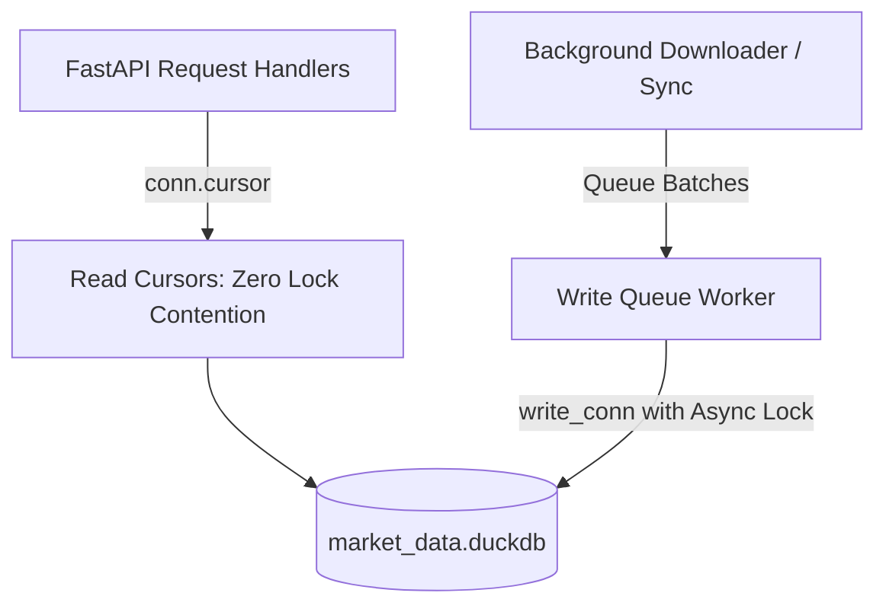

# Phase 02: Database Architecture, Schemas & DuckDB Concurrency Engine

```yaml
EXECUTION_CONTRACT:
  depends_on:
    - "plan/00_MASTER_ARCHITECTURE.md"
    - "plan/01_ENVIRONMENT_CONFIG_AND_AUTH.md"
  reads:
    - "plan/00A_CONTRACTS_AND_CONVENTIONS.md#1-canonical-interface-registry"
    - "plan/00A_CONTRACTS_AND_CONVENTIONS.md#4-canonical-database-schema-registry"
    - "plan/00A_CONTRACTS_AND_CONVENTIONS.md#8-process--concurrency-architecture"
    - "plan/VERIFICATION_REPORT.md#26-duckdb-concurrency--art-index-overhead-on-100m-rows"
  produces:
    - "db/connection.py"
    - "db/migrations.py"
    - "db/repositories/duckdb_candle_repo.py"
    - "db/repositories/duckdb_symbol_repo.py"
    - "db/repositories/duckdb_checkpoint_repo.py"
  exposes:
    - "ICandleReader"
    - "ICandleWriter"
    - "ISymbolRepository"
    - "ICheckpointRepository"
  must_not_modify:
    - "plan/*"
    - "services/*"
  test_plan:
    unit_tests: "tests/unit/test_duckdb_repositories.py"
    integration_tests: "tests/integration/test_duckdb_concurrency.py"
    contract_tests: "tests/contract/test_repository_contracts.py"
    fixtures: "tests/fixtures/sample_candles.json"
    command: "pytest tests/unit/test_duckdb_repositories.py tests/integration/test_duckdb_concurrency.py -v"
  definition_of_done:
    - item: 1
      command: "python -c 'from db.migrations import init_db; init_db(); from db.connection import get_db; conn = get_db().get_read_cursor(); tables = conn.execute(\"SHOW TABLES\").fetchall(); assert (\"candles_1m_raw\",) in tables and (\"schema_version\",) in tables'"
      result: "Database file initialized with all canonical tables including schema_version and raw candle storage."
    - item: 2
      command: "pytest tests/integration/test_duckdb_concurrency.py"
      result: "Reader threads execute queries concurrently without waiting on write locks; zero database locked exceptions under 50 concurrent reader queries."
    - item: 3
      command: "python -c 'from db.connection import get_db; conn = get_db().get_read_cursor(); res = conn.execute(\"SELECT version FROM schema_version\").fetchall(); assert len(res) >= 1'"
      result: "schema_version table records migration 1.0.0 as applied."
  failure_modes_and_recovery:
    - failure: "Stale lock file prevents DuckDB initialization"
      detection: "duckdb.IOException: Could not set lock on file 'market_data.duckdb'"
      recovery: "Health probe checks if owning PID is active. If inactive, logs recovery prompt or safely releases lock file"
    - failure: "Slowdown on 100M+ bulk inserts due to index overhead"
      detection: "Batch insertion throughput drops below 10,000 rows/second"
      recovery: "Switch to staging table + anti-join deduplication path (db/repositories/duckdb_candle_repo.py::stage_and_merge_1m)"
  handoff:
    - "DuckDB connection manager with non-blocking read cursors implemented."
    - "Relational DDL schemas and migration engine initialized."
    - "Ready for Phase 03 NSE symbol master ingestion."
```

---

## 1. Goal & Scope
Design and implement the high-performance DuckDB columnar storage engine, relational schemas, migration manager, and single-process concurrency architecture adhering to the 00A Canonical Registry.

This phase delivers:
- Exact relational DDL schemas with versioned migrations (`schema_version`, `symbols`, `candles_1m_raw`, `candles_1d_raw`, `corporate_actions`, `adjustment_factors`, `download_checkpoints`, `market_holidays`, `job_logs`).
- Decoupled raw storage and dynamic split-adjusted SQL views (`candles_1m_adjusted`, `candles_1d_adjusted`).
- Single-process concurrency architecture resolving DuckDB's single-writer limitation: background writes serialize through a dedicated queue worker while API queries acquire non-blocking read cursors (`conn.cursor()`).
- High-throughput ingestion design: staging table + anti-join deduplication strategy to avoid ART index memory bottlenecks on 100M+ row tables.
- Repositories implementing canonical interfaces (`ICandleReader`, `ICandleWriter`, `ISymbolRepository`, `ICheckpointRepository`).

---

## 2. SOLID Principles Application
- **Single Responsibility Principle (SRP)**:
  - `DuckDBConnectionManager`: Solely responsible for initializing the database file, holding the single write connection, and dispensing thread-local read cursors.
  - `CandleRepository`: Implements `ICandleReader` and `ICandleWriter` for time-series persistence.
  - `CheckpointRepository`: Implements `ICheckpointRepository` for state-machine tracking.
- **Interface Segregation Principle (ISP)**:
  - Read-heavy API controllers depend strictly on `ICandleReader`. They cannot invoke mutating methods from `ICandleWriter`.
- **Dependency Inversion Principle (DIP)**:
  - Domain services inject repository interfaces (`ICandleReader`), making it seamless to substitute in-memory DuckDB instances for unit testing.

---

## 3. Storage Optimization & Row-Count Math

### 3.1. Mathematical Sizing for Indian Market (NSE)
- **Trading Days per Year**: ~250 trading days (accounting for weekends and national holidays).
- **Intraday 1-Minute Bars per Day**: 09:15 to 15:30 IST = 6 hours 15 minutes = **375 bars/day**.
- **Per-Stock 1m Volume**:
  - 1 Year = $250 \times 375 = 93,750$ rows.
  - 5 Years (Target Intraday History) = $5 \times 93,750 = \mathbf{468,750\text{ rows}}$.
- **Per-Stock 1D Volume**:
  - 15 Years = $15 \times 250 = \mathbf{3,750\text{ rows}}$.
- **Nifty 500 Universe (1m Intraday Scope)**:
  - $500\text{ stocks} \times 468,750\text{ rows} = \mathbf{234,375,000\text{ rows}}$ (~234.4 Million rows).
- **All Active Stocks (1D Daily Scope, ~2,000 Stocks)**:
  - $2,000\text{ stocks} \times 3,750\text{ rows} = \mathbf{7,500,000\text{ rows}}$ (~7.5 Million rows).

### 3.2. DuckDB Compression & Disk Footprint
- DuckDB utilizes columnar bit-packing, dictionary encoding, and ALP (Adaptive Lossless Floating-Point) compression.
- An OHLCV record (Symbol VARCHAR, Timestamp TIMESTAMP/DATE, Open DOUBLE, High DOUBLE, Low DOUBLE, Close DOUBLE, Volume BIGINT) compresses to **10 to 14 bytes per row** in persistent DuckDB storage.
- **Projected Storage Footprint**:
  - 1 Stock (5-year 1m): $468,750 \times 12\text{ bytes} \approx \mathbf{5.6\text{ MB}}$.
  - Nifty 500 (5-year 1m): $234.4\text{M} \times 12\text{ bytes} \approx \mathbf{2.8\text{ to } 3.3\text{ GB}}$.
  - Total Database File Size (including 1D, metadata, checkpoints): **~3.5 to 4.5 GB**.

---

## 4. Indexing & Deduplication Strategy on 100M+ Rows

### 4.1. The ART Index Problem
DuckDB builds an Adaptive Radix Tree (ART) index for `PRIMARY KEY` or `UNIQUE` constraints. When a table scales beyond 50M to 100M rows, maintaining this index during high-frequency batch inserts causes:
1. Significant memory bloat (ART index stays memory-resident).
2. Throughput degradation as every inserted candle must traverse the index tree to enforce uniqueness.

### 4.2. High-Throughput Staging & Anti-Join Deduplication (Primary Design)
To achieve sustained write speeds of $\ge 25,000$ rows/second:
1. `candles_1m_raw` is created WITHOUT a heavy primary key constraint. Data is physically inserted ordered by `(symbol, timestamp)` to activate DuckDB columnar **Zone Maps** (min/max range pruning).
2. During batch ingestion, incoming candles are written into a temporary in-memory staging table:
   ```sql
   CREATE TEMP TABLE staging_1m AS SELECT * FROM arrow_table;
   ```
3. Staged records are merged into the master table with anti-join deduplication:
   ```sql
   INSERT INTO candles_1m_raw
   SELECT s.* FROM staging_1m s
   WHERE NOT EXISTS (
       SELECT 1 FROM candles_1m_raw c
       WHERE c.symbol = s.symbol 
         AND c.timestamp = s.timestamp
   );
   DROP TABLE staging_1m;
   ```
4. **Phase 09 Benchmark Gate**: In Milestone 1, run synthetic scaling benchmarks at 1M, 10M, and 100M rows comparing (A) `PRIMARY KEY` table vs (B) Staging anti-join table. Measure write throughput, peak RAM, and range-query latency.

---

## 5. Database Schema Specifications (DDL)

```sql
-- Schema Migration Tracking
CREATE TABLE IF NOT EXISTS schema_version (
    version VARCHAR PRIMARY KEY,
    applied_at TIMESTAMP DEFAULT CURRENT_TIMESTAMP,
    description VARCHAR NOT NULL
);

-- Master Instruments Table
CREATE TABLE IF NOT EXISTS symbols (
    symbol VARCHAR PRIMARY KEY,
    name VARCHAR NOT NULL,
    isin VARCHAR,
    exchange VARCHAR DEFAULT 'NSE',
    segment VARCHAR DEFAULT 'EQUITY',
    series VARCHAR DEFAULT 'EQ',
    lot_size INTEGER DEFAULT 1,
    tick_size DOUBLE DEFAULT 0.05,
    category VARCHAR,
    tier INTEGER NOT NULL DEFAULT 4,
    priority_rank INTEGER DEFAULT 9999,
    listing_date DATE,
    is_active BOOLEAN DEFAULT TRUE,
    updated_at TIMESTAMP DEFAULT CURRENT_TIMESTAMP
);

-- Raw Intraday 1-Minute Candles
CREATE TABLE IF NOT EXISTS candles_1m_raw (
    symbol VARCHAR NOT NULL,
    timestamp TIMESTAMP NOT NULL,
    open DOUBLE NOT NULL,
    high DOUBLE NOT NULL,
    low DOUBLE NOT NULL,
    close DOUBLE NOT NULL,
    volume BIGINT NOT NULL
);

-- Raw Daily EOD Candles
CREATE TABLE IF NOT EXISTS candles_1d_raw (
    symbol VARCHAR NOT NULL,
    date DATE NOT NULL,
    open DOUBLE NOT NULL,
    high DOUBLE NOT NULL,
    low DOUBLE NOT NULL,
    close DOUBLE NOT NULL,
    volume BIGINT NOT NULL
);

-- Official Corporate Actions Feed
CREATE TABLE IF NOT EXISTS corporate_actions (
    id VARCHAR PRIMARY KEY,
    symbol VARCHAR NOT NULL,
    action_type VARCHAR NOT NULL,
    ex_date DATE NOT NULL,
    record_date DATE,
    ratio_from DOUBLE,
    ratio_to DOUBLE,
    dividend_amount DOUBLE,
    description VARCHAR,
    created_at TIMESTAMP DEFAULT CURRENT_TIMESTAMP
);

-- Calculated Adjustment Factors
CREATE TABLE IF NOT EXISTS adjustment_factors (
    symbol VARCHAR NOT NULL,
    ex_date DATE NOT NULL,
    factor_price DOUBLE NOT NULL,
    factor_volume DOUBLE NOT NULL,
    PRIMARY KEY (symbol, ex_date)
);

-- Resumable Download Checkpoints
CREATE TABLE IF NOT EXISTS download_checkpoints (
    symbol VARCHAR NOT NULL,
    timeframe VARCHAR NOT NULL,
    earliest_ts TIMESTAMP,
    latest_ts TIMESTAMP,
    total_candles INTEGER DEFAULT 0,
    status VARCHAR DEFAULT 'PENDING',
    consecutive_empty_count INTEGER DEFAULT 0,
    last_attempt_at TIMESTAMP,
    error_message VARCHAR,
    PRIMARY KEY (symbol, timeframe)
);

-- Market Trading Calendar & Holidays
CREATE TABLE IF NOT EXISTS market_holidays (
    holiday_date DATE PRIMARY KEY,
    description VARCHAR NOT NULL,
    is_special_session BOOLEAN DEFAULT FALSE,
    trading_start TIME DEFAULT '09:15:00',
    trading_end TIME DEFAULT '15:30:00'
);

-- Operational Execution Logs
CREATE TABLE IF NOT EXISTS job_logs (
    job_id VARCHAR PRIMARY KEY,
    job_type VARCHAR NOT NULL,
    started_at TIMESTAMP NOT NULL,
    completed_at TIMESTAMP,
    symbols_processed INTEGER DEFAULT 0,
    symbols_failed INTEGER DEFAULT 0,
    total_candles_ingested BIGINT DEFAULT 0,
    status VARCHAR NOT NULL,
    details VARCHAR
);
```

---

## 6. Concurrency Architecture & Connection Management

### 6.1. Dedicated Writer vs Non-Blocking Readers


1. **The Single Writer Thread**:
   - `DuckDBConnectionManager` initializes exactly ONE `write_conn` instance.
   - All mutations (`INSERT`, `UPDATE`, `DELETE`, checkpoint updates) are placed onto a memory queue and processed sequentially.
   - Batch writes commit in brief transactions (< 80ms) followed by immediate lock release.
2. **Concurrent Read Cursors**:
   - Query endpoints call `connection_manager.get_read_cursor()`, which returns an independent cursor from the parent connection.
   - Readers do **NOT** acquire the write lock. Multiple API queries (chart loading, indicator calculation, screener scans) execute in parallel without being blocked by background ingestion.
3. **Event Loop Safety**:
   - Blocking DuckDB SQL operations are wrapped in `asyncio.to_thread()` to prevent blocking the FastAPI async event loop.

---

## 7. Implementation Steps
1. Create `db/connection.py` implementing `DuckDBConnectionManager` with single `write_conn` and cursor factory.
2. Create `db/migrations.py` implementing `init_db()` and version tracking in `schema_version`.
3. Implement `db/repositories/duckdb_candle_repo.py` (`ICandleReader`, `ICandleWriter`).
4. Implement `db/repositories/duckdb_symbol_repo.py` (`ISymbolRepository`).
5. Implement `db/repositories/duckdb_checkpoint_repo.py` (`ICheckpointRepository`).
6. Write integration tests simulating 50 concurrent read queries running during an active 100,000-row batch write.

---

## 8. Verification & Acceptance Criteria
- Running `init_db()` creates `data/market_data.duckdb` with all 9 canonical tables and initializes `schema_version` with version `'1.0.0'`.
- Deduplication test: Staging and merging identical candle batches results in zero duplicate timestamps.
- Zone Map pruning test: `EXPLAIN SELECT * FROM candles_1m_raw WHERE symbol='NSE:RELIANCE-EQ' AND timestamp BETWEEN ...` confirms filter pushdown without full table scan.
- Multi-threaded concurrency test: 50 concurrent reader queries complete with $P95 < 25\text{ ms}$ while a background writer commits 50,000 candles every 200ms with zero lock errors.
