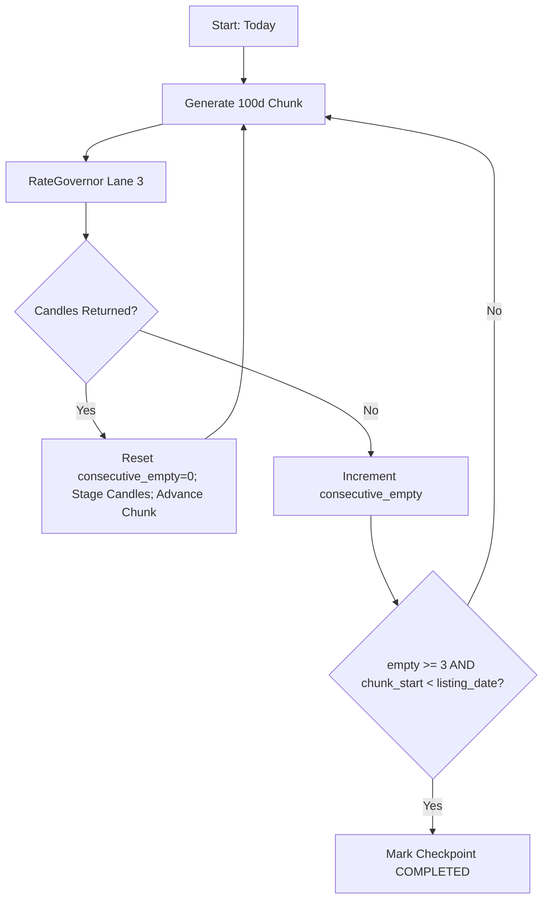

# Phase 04: Historical Ingestion Engine, Rate Limiting & Resilient Checkpointing

```yaml
EXECUTION_CONTRACT:
  depends_on:
    - "plan/00_MASTER_ARCHITECTURE.md"
    - "plan/01_ENVIRONMENT_CONFIG_AND_AUTH.md"
    - "plan/02_DATABASE_SCHEMA_AND_DUCKDB_ENGINE.md"
    - "plan/03_SYMBOL_MASTER_AND_UNIVERSE_MANAGER.md"
  reads:
    - "plan/00A_CONTRACTS_AND_CONVENTIONS.md#1-canonical-interface-registry"
    - "plan/00A_CONTRACTS_AND_CONVENTIONS.md#6-canonical-configuration-key-registry"
    - "plan/00A_CONTRACTS_AND_CONVENTIONS.md#7-global-rategovernor-specification"
    - "plan/VERIFICATION_REPORT.md#21-fyers-api-v3-rate-limits--quotas"
    - "plan/VERIFICATION_REPORT.md#22-fyers-historical-data-range-limits"
    - "plan/VERIFICATION_REPORT.md#23-fyers-history-error-taxonomy--end-of-history-condition"
  produces:
    - "core/rate_governor.py"
    - "services/chunk_generator.py"
    - "services/downloader_service.py"
    - "services/fyers_client.py"
    - "scripts/run_historical_download.py"
  exposes:
    - "IMarketDataProvider"
    - "ICandleWriter"
    - "ICheckpointRepository"
  must_not_modify:
    - "plan/*"
    - "db/migrations.py"
  test_plan:
    unit_tests: "tests/unit/test_chunk_generator.py tests/unit/test_rate_governor.py"
    integration_tests: "tests/integration/test_downloader_resumption.py"
    contract_tests: "tests/contract/test_market_data_provider_contract.py"
    fixtures: "tests/fixtures/fyers_response_1m_reliance.json"
    command: "pytest tests/unit/test_chunk_generator.py tests/unit/test_rate_governor.py tests/contract/test_market_data_provider_contract.py -v"
  definition_of_done:
    - item: 1
      command: "python -c 'from core.rate_governor import RateGovernor; rg = RateGovernor(); assert rg.target_per_min == 180 and rg.burst_per_sec == 10'"
      result: "Global RateGovernor initialized with verified 180/min target and 10/s burst ceiling."
    - item: 2
      command: "pytest tests/unit/test_chunk_generator.py"
      result: "Generates exactly 100-day 1m chunks and 366-day 1D chunks without calendar gaps or overlaps."
    - item: 3
      command: "pytest tests/integration/test_downloader_resumption.py"
      result: "Simulated interruption (SIGINT) cleanly commits in-flight checkpoint; resumption restarts at exact uncompleted chunk with zero duplicate rows in DuckDB."
  failure_modes_and_recovery:
    - failure: "Fyers HTTP 429 (Too Many Requests)"
      detection: "HTTP 429 returned or Fyers error envelope s == 'error' and code == 429"
      recovery: "RateGovernor automatically throttles target to 120 req/min for 5 minutes, backs off starting at 2.0s with randomized jitter"
    - failure: "Transient error -300 returned on valid symbol"
      detection: "Fyers response payload contains code -300"
      recovery: "Do NOT mark end-of-history; execute exponential backoff retry (up to 5 attempts) before flagging symbol chunk"
  handoff:
    - "Global RateGovernor and chunk generator implemented."
    - "Historical downloader with resilient checkpointing operational."
    - "Ready for Phase 05 in-database resampling and quant metrics."
```

---

## 1. Goal & Scope
Build a fault-tolerant, rate-limited, multi-year historical data ingestion engine for 1-minute (`1m`) and Daily (`1D`) resolutions adhering to the 00A Canonical Registry.

This phase delivers:
- Exact calendar-day chunking mathematics conforming to verified Fyers v3 API limits (100 calendar days for 1m, 366 calendar days for 1D).
- Centralized execution through the Global `RateGovernor`: 180 req/min sustained target (under the 200/min cap), 10 req/sec burst bucket, and 90,000 req/day soft ceiling.
- Strict three-lane priority queuing: Interactive UI (Lane 1) > Incremental EOD Sync (Lane 2) > Historical Backfill (Lane 3).
- Resilient state-machine checkpointing in `download_checkpoints` storing `earliest_ts` and `latest_ts` (`TIMESTAMP`).
- Robust stop-condition logic replacing naive "empty response = end of history" rules.
- Complete mapping of Fyers error codes (`-300`, `429`, `-353`, `-339`, `-16`, `401`, `5xx`) to automated retry, backoff, and recovery actions.

---

## 2. SOLID Principles Application
- **Single Responsibility Principle (SRP)**:
  - `RateGovernor`: Responsible solely for multi-lane token bucket rate regulation and daily quota tracking.
  - `CalendarChunker`: Responsible solely for calculating `(range_from, range_to)` calendar-day intervals.
  - `FyersMarketDataProvider`: Implements `IMarketDataProvider`, handling network HTTP requests and payload parsing.
  - `HistoricalDownloader`: Coordinates symbol iteration, checkpoint transitions, and batch persistence.
- **Open/Closed Principle (OCP)**:
  - Upstream data providers implement `IMarketDataProvider`. A simulation provider or alternate broker feed can be swapped in without modifying downloader or chunking code.
- **Dependency Inversion Principle (DIP)**:
  - Downloader depends strictly on abstractions: `IMarketDataProvider`, `ICandleWriter`, `ICheckpointRepository`.

---

## 3. Verified Fyers Ingestion Constraints & Request Math

### 3.1. Verified Upstream Limits
| Parameter | Verified Broker Limit | Application Target (RateGovernor) | Architectural Rationale |
|---|---|---|---|
| **Burst Limit** | 10 requests / second | 10 requests / second | Token bucket capacity = 10 tokens |
| **Per-Minute Limit** | 200 requests / minute | **180 requests / minute** | 10% safety buffer; >3 breaches/day triggers automated account block |
| **Daily Quota Cap** | 100,000 requests / day | **90,000 requests / day** | 10,000 request reserve for interactive charts and options sync |
| **1m Max Window** | **100 Calendar Days** | 100 Calendar Days | Error `-353` returned on 101+ calendar days |
| **1D Max Window** | **366 Calendar Days** | 365/366 Calendar Days | Error `-339` returned on 367+ calendar days |

*Critical Note*: Fyers strictly counts **CALENDAR days**, not trading days. A request spanning `2024-01-01` to `2024-04-10` is exactly 100 calendar days.

### 3.2. Initial Full-Universe Ingestion Math & Time Estimates

#### 1-Minute (`1m`) Intraday Scope: Nifty 500 (500 Stocks)
- **Target History**: 5 Years = $5 \times 365 = 1,825\text{ calendar days}$.
- **Chunks per Stock**: $\lceil 1,825 / 100 \rceil = \mathbf{19\text{ requests / stock}}$.
- **Requests per Tier**:
  - Tier 1 (Nifty 100): $100 \times 19 = \mathbf{1,900\text{ requests}}$.
  - Tier 2 (Midcap 150): $150 \times 19 = \mathbf{2,850\text{ requests}}$.
  - Tier 3 (Smallcap 250): $250 \times 19 = \mathbf{4,750\text{ requests}}$.
  - **Total Nifty 500 (1m)**: $1,900 + 2,850 + 4,750 = \mathbf{9,500\text{ requests}}$.
- **Wall-Clock Duration at 180 req/min (3.0 req/sec)**:
  $$\text{Duration} = \frac{9,500\text{ requests}}{180\text{ req/min}} = 52.78\text{ minutes} \approx \mathbf{53\text{ minutes}}.$$
  *(Tier 1 alone completes in just $1,900 / 180 \approx \mathbf{10.6\text{ minutes}}$!)*

#### Daily (`1D`) Scope: All Active Equities (~2,000 Stocks)
- **Target History**: 15 Years = $15 \times 365 = 5,475\text{ calendar days}$.
- **Chunks per Stock**: $\lceil 5,475 / 366 \rceil = \mathbf{15\text{ requests / stock}}$.
- **Total Universe (1D)**: $2,000 \times 15 = \mathbf{30,000\text{ requests}}$.
- **Wall-Clock Duration at 180 req/min**:
  $$\text{Duration} = \frac{30,000\text{ requests}}{180\text{ req/min}} = 166.67\text{ minutes} \approx \mathbf{2.8\text{ hours}}.$$

#### Total Initial Backfill Budget (Day 1 Execution)
- Total Requests: $9,500\text{ (1m)} + 30,000\text{ (1D)} = \mathbf{39,500\text{ requests}}$.
- $39,500 \ll 90,000\text{ daily cap}$.
- **Total Initial Ingestion completes fully in $\sim 3.7\text{ hours}$ on Day 1 without exceeding daily quotas or per-minute rate limits.**

#### Daily Incremental Sync Budget (Subsequent Days)
- 1m Delta (Nifty 500): 1 request / stock = 500 requests.
- 1D Delta (All Stocks): 1 request / stock = 2,000 requests.
- Total Daily Sync Requests: $500 + 2,000 = \mathbf{2,500\text{ requests}}$.
- Daily Sync Duration: $2,500 / 180 \approx \mathbf{13.9\text{ minutes}}$ every evening at 15:45 IST.

---

## 4. Chunking Algorithm & Robust Stop-Condition Logic

### 4.1. Backward-Walking Chunk Generator
To ensure the freshest data is immediately usable:
1. `range_to = TODAY`.
2. `range_from = range_to - timedelta(days=99)` (for 1m) or `- timedelta(days=365)` (for 1D).
3. Dispatch request via RateGovernor Lane 3.
4. Process returned candles:
   - Sanitize, deduplicate, and stage for insertion.
   - Advance window: `range_to = range_from - timedelta(days=1)`.

### 4.2. Robust End-of-History Condition (Defect Fix)
In old designs, receiving a single empty response or error stopped the download prematurely. Under the upgraded engine, the loop terminates for a symbol **ONLY IF BOTH of the following conditions are met**:
1. **Consecutive Empty Count**: `consecutive_empty_count >= 3` (three successive 100-day chunks return 0 candles).
2. **Listing Date Boundary**: `current_range_from < symbol.listing_date` (or before 2017-01-01 if listing date is unknown).
- If empty chunks are returned while `current_range_from >= symbol.listing_date`: increment `consecutive_empty_count`, log warning, and continue walking backward.



---

## 5. Upstream Error Taxonomy & Automated Remediation

| Error Code / Status | Meaning | Action / Remediation |
|---|---|---|
| **`429`** | HTTP Too Many Requests | RateGovernor throttles target from 180 to 120 req/min for 5 min; exponential backoff: $2.0\text{s} \times 2^n + \text{jitter}$. Max 5 retries. |
| **`-300`** | Transient Fyers Internal Error | Do NOT abort. Sleep 1.5s, retry chunk up to 5 times. If all 5 fail, mark chunk skipped and continue. |
| **`500`, `502`, `504`**| Broker Gateway / Server Glitch | Retry with backoff (2s, 4s, 8s, 16s). |
| **`-353`** | Range Exceeded 100 Days (1m) | Fatal algorithmic error in chunker. Log critical bug, truncate window to 99 days, retry. |
| **`-339`** | Range Exceeded 366 Days (1D) | Fatal algorithmic error in chunker. Truncate window to 365 days, retry. |
| **`-16`, `401`** | Token Expired | Halt Lane 3 worker immediately; invoke `IAuthService.refresh_token_if_needed()`. If refresh fails, set status `FAILED_AUTH` and alert user. |
| **Invalid Symbol** | Delisted or Corrupt Ticker | Mark checkpoint `FAILED` with reason, commit log, proceed to next symbol. Never crash worker. |

---

## 6. Implementation Steps
1. Create `core/rate_governor.py` implementing dual token buckets (10 burst, 180/min target, 90,000/day cap) with 3 priority lanes.
2. Create `services/chunk_generator.py` producing non-overlapping calendar-day intervals.
3. Create `services/fyers_client.py` implementing `IMarketDataProvider` wrapping `fyers_apiv3` with error taxonomy handling.
4. Implement `HistoricalDownloader` service:
   - Queries `ISymbolRepository` sorted by `tier` and `priority_rank`.
   - Reads/writes state from `ICheckpointRepository`.
   - Batch inserts candles into `ICandleWriter` via staging anti-join deduplication.
5. Provide thread-safe control toggles: `start()`, `pause()`, `resume()`, `cancel()`.

---

## 7. Verification & Acceptance Criteria
- RateGovernor strictly limits requests: in a 1,000-request benchmark, maximum rate never exceeds 180 req/min; zero HTTP 429 errors.
- Preemption test: When a background backfill is running in Lane 3, dispatching a Lane 1 interactive request executes immediately with $< 350\text{ ms}$ latency.
- Resumption test: Manually terminating the downloader via `SIGINT` during ingestion leaves `download_checkpoints` intact. Resuming restarts at the exact uncommitted timestamp without re-requesting completed chunks.
- Stop-condition test: Simulated empty responses on valid symbols do not terminate download until 3 consecutive empty chunks occur prior to listing date.
- All stored candles pass OHLC sanity checks (`High >= Low`, `Volume >= 0`).
