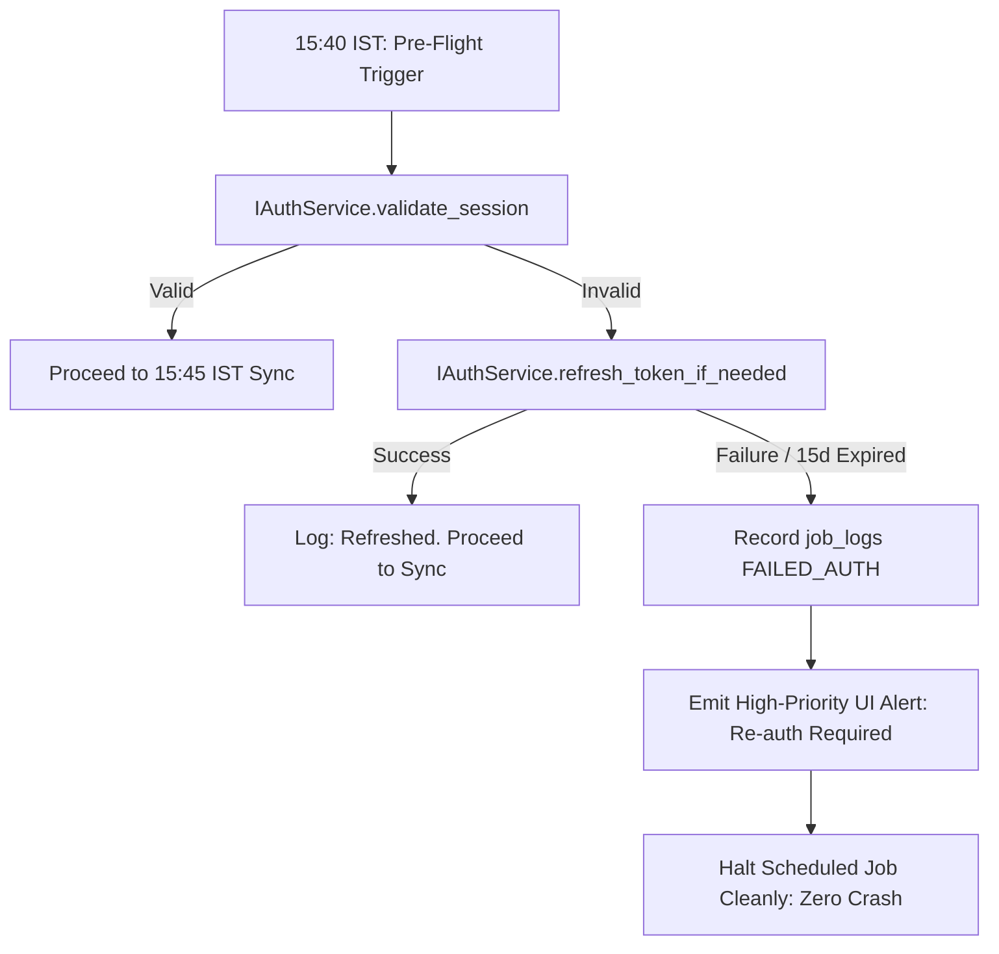

# Phase 06: Daily Incremental Ingestion Engine & Automated Scheduler

```yaml
EXECUTION_CONTRACT:
  depends_on:
    - "plan/00_MASTER_ARCHITECTURE.md"
    - "plan/01_ENVIRONMENT_CONFIG_AND_AUTH.md"
    - "plan/02_DATABASE_SCHEMA_AND_DUCKDB_ENGINE.md"
    - "plan/03_SYMBOL_MASTER_AND_UNIVERSE_MANAGER.md"
    - "plan/04_HISTORICAL_DOWNLOADER_ENGINE.md"
  reads:
    - "plan/00A_CONTRACTS_AND_CONVENTIONS.md#1-canonical-interface-registry"
    - "plan/00A_CONTRACTS_AND_CONVENTIONS.md#4-canonical-database-schema-registry"
    - "plan/00A_CONTRACTS_AND_CONVENTIONS.md#7-global-rategovernor-specification"
    - "plan/VERIFICATION_REPORT.md#21-fyers-api-v3-rate-limits--quotas"
  produces:
    - "services/scheduler_service.py"
    - "services/incremental_sync_service.py"
    - "services/trading_calendar.py"
    - "scripts/run_daily_sync.py"
  exposes:
    - "ICandleWriter"
    - "ICheckpointRepository"
  must_not_modify:
    - "plan/*"
    - "db/migrations.py"
  test_plan:
    unit_tests: "tests/unit/test_trading_calendar.py tests/unit/test_scheduler_timing.py"
    integration_tests: "tests/integration/test_missed_run_catchup.py"
    contract_tests: "tests/contract/test_sync_job_contract.py"
    fixtures: "tests/fixtures/mock_daily_candles.json"
    command: "pytest tests/unit/test_trading_calendar.py tests/integration/test_missed_run_catchup.py -v"
  definition_of_done:
    - item: 1
      command: "python -c 'from services.trading_calendar import TradingCalendar; tc = TradingCalendar(); assert not tc.is_trading_day(\"2024-01-26\")'"
      result: "Calendar correctly flags Republic Day (and weekends) as non-trading sessions."
    - item: 2
      command: "pytest tests/integration/test_missed_run_catchup.py"
      result: "Startup recovery detects missed sessions, fetches missing delta chunks, and updates checkpoints with zero duplicate records."
    - item: 3
      command: "python -c 'from services.scheduler_service import get_cron_expression; assert get_cron_expression() == \"45 15 * * 1-5\"'"
      result: "Valid 5-field cron expression configured for 15:45 IST Monday through Friday."
  failure_modes_and_recovery:
    - failure: "Fyers token expired at 15:40 IST pre-flight check"
      detection: "validate_session() returns False and refresh_token_if_needed() fails"
      recovery: "Scheduler marks job status as FAILED_AUTH in job_logs, emits high-priority UI notification, and enters standby without crashing"
    - failure: "Exchange settlement delayed past 15:45 IST"
      detection: "Returned today's candle has volume == 0 or close != final bhavcopy"
      recovery: "Scheduler re-schedules an idempotent reconciliation run at 18:30 IST"
  handoff:
    - "Daily scheduler with missed-run catchup operational."
    - "Post-market 15:45 IST incremental sync wired into RateGovernor Lane 2."
    - "Ready for Phase 07 FastAPI backend and streaming exporters."
```

---

## 1. Goal & Scope
Build an automated, incremental daily synchronization daemon that runs after market close to keep the DuckDB historical database synchronized with zero human intervention adhering to the 00A Canonical Registry.

This phase delivers:
- A Market Calendar Evaluator querying DuckDB `market_holidays` (populated via Phase 03 automated script), automatically skipping weekends and exchange holidays while supporting Muhurat sessions.
- Incremental delta calculator reading `latest_ts` from `download_checkpoints`, downloading only newly settled candles, and idempotently re-fetching the current day to capture finalized post-market settlement prices.
- Low-overhead request budget: exactly 2,500 requests daily (500 1m for Nifty 500 + 2,000 1D for all active equities), completing in **~13.9 minutes** via RateGovernor Lane 2.
- Fixed 5-field cron trigger: `45 15 * * 1-5` (`Asia/Kolkata` timezone).
- Missed-run catch-up state machine: on system launch, the scheduler checks if the last trading session was missed and runs an immediate catch-up if the market is closed.
- Pre-flight token probe at 15:40 IST with graceful transition to `FAILED_AUTH` on failure.

---

## 2. SOLID Principles Application
- **Single Responsibility Principle (SRP)**:
  - `TradingCalendar`: Solely responsible for verifying trading days and market session open/close boundaries.
  - `IncrementalSyncService`: Solely responsible for calculating delta date ranges and executing batch updates.
  - `SchedulerService`: Solely responsible for cron timing, pre-flight checks, and missed-run detection.
- **Open/Closed Principle (OCP)**:
  - Notification dispatchers implement an `IAlertNotifier` interface (logging, console banner, web UI push, email/webhook), allowing alert destinations to expand without modifying scheduler logic.
- **Dependency Inversion Principle (DIP)**:
  - The scheduler depends on `IIncrementalSyncService` and `IAuthService` abstractions.

---

## 3. Indian Market Operational Timing & Chronology

```
15:30:00 IST    Market Closes (Normal Equity Session)
     │
15:30 - 15:40   Exchange Post-Closing Session & Weighted Average Price Calculation
     │
15:40:00 IST    Pre-Flight Token Validation Probe (5 min prior to sync)
     │          - IAuthService.validate_session() probes Fyers profile
     │          - If expired: attempts refresh_token_if_needed()
     │          - If failed: flags job FAILED_AUTH, notifies user, halts sync
     │
15:45:00 IST    Automated Daily Incremental Sync Triggers (Cron: 45 15 * * 1-5)
     │          - 2,500 total requests routed through RateGovernor Lane 2
     │          - Finishes in ~13.9 minutes (~15:59 IST)
     │
16:00:00 IST    DuckDB Maintenance Checkpoint
     │          - Executes CHECKPOINT to flush WAL to disk
     │
18:30:00 IST    Optional Reconciliation Pass (Bhavcopy UDiFF verification)
```

---

## 4. Incremental Delta Mathematics & Request Budget

### 4.1. Daily Request Budget Math
Unlike multi-year backfills, daily maintenance is lightweight:
- **1-Minute (`1m`) Delta**:
  - Universe: Nifty 500 constituents = 500 stocks.
  - Since delta is 1 calendar day $\le 100\text{ days}$, exactly **1 request / stock** is required.
  - Total 1m Requests: $500 \times 1 = \mathbf{500\text{ requests}}$.
- **Daily (`1D`) Delta**:
  - Universe: All active NSE equities = ~2,000 stocks.
  - Exactly **1 request / stock** is required.
  - Total 1D Requests: $2,000 \times 1 = \mathbf{2,000\text{ requests}}$.
- **Total Daily Requests**: $500 + 2,000 = \mathbf{2,500\text{ requests}}$.

### 4.2. Execution Time at 180 req/min (RateGovernor Lane 2)
$$\text{Duration} = \frac{2,500\text{ requests}}{180\text{ requests / minute}} = 13.89\text{ minutes} \approx \mathbf{13.9\text{ minutes}}.$$
- Execution completes well before 16:00 IST, consuming only 2.5% of the 100,000 daily request quota.

### 4.3. Delta Computation Algorithm
For each active symbol:
1. Query `download_checkpoints` for resolution (`'1m'` or `'1D'`):
   - Retrieve `checkpoint.latest_ts`.
2. **Idempotent Day Re-fetch Rule**:
   - Because intra-session data downloaded prior to 15:30 IST might lack finalized closing trade adjustments, `range_from` is set to `CAST(latest_ts AS DATE)`.
   - `range_to = TODAY`.
3. Fetch chunk via RateGovernor Lane 2 (`IMarketDataProvider.fetch_candles`).
4. Stage returned candles into temporary in-memory table.
5. Merge with anti-join deduplication:
   - Duplicates from previous partial downloads are cleanly ignored.
   - New closing candles are inserted.
6. Update checkpoint: `latest_ts = MAX(timestamp)`, `status = 'COMPLETED'`.

---

## 5. Missed-Run Catch-Up & Token Failure State Machine

### 5.1. Missed-Run Catch-Up Architecture
If the host machine is turned off during the 15:45 IST window:
1. On application launch (`main.py`), `SchedulerService.check_missed_runs()` triggers.
2. Checks current time:
   - If market is currently open (`09:15 to 15:30 IST`), logs `"Market currently active. Delaying catch-up until 15:45 IST"` to prevent competing with interactive user queries.
   - If market is closed (`> 15:40 IST` or weekend):
     - Queries `download_checkpoints WHERE latest_ts < LAST_SETTLED_TRADING_DAY`.
     - Automatically fires sequential catch-up for all pending symbols.

### 5.2. Pre-Flight Token Failure Handling
At 15:40 IST:


---

## 6. Implementation Steps
1. Create `services/trading_calendar.py`:
   - Queries `market_holidays` in DuckDB.
   - Methods: `is_trading_day(dt: date) -> bool`, `get_previous_trading_day() -> date`.
2. Create `services/incremental_sync_service.py`:
   - Implements `sync_daily_delta(symbols: list[str])`.
   - Executes batched transaction writes.
3. Create `services/scheduler_service.py`:
   - Uses `asyncio` task loop running inside the single Python process.
   - Cron trigger: `45 15 * * 1-5` (`Asia/Kolkata`).
   - Implements `check_missed_runs()` on startup.
4. Expose REST endpoints in `api/v1/system.py`:
   - `POST /api/v1/system/sync/trigger`: Manual on-demand sync trigger.
   - `GET /api/v1/system/sync/status`: Real-time status of sync engine.

---

## 7. Verification & Acceptance Criteria
- Running on a weekend or exchange holiday exits in $< 10\text{ ms}$ with explicit log and zero API calls.
- Simulated delta sync on RELIANCE fetches exactly today's 375 1m candles and 1 daily candle.
- Re-running the sync on the same evening produces 0 duplicate records in DuckDB.
- Missed-run catch-up test: Advancing system clock past 15:45 while application is stopped, then restarting, initiates automated catch-up.
- Simulated token expiration at 15:40 IST halts the scheduler cleanly, marks `job_logs.status = 'FAILED_AUTH'`, and produces zero uncaught exceptions.
