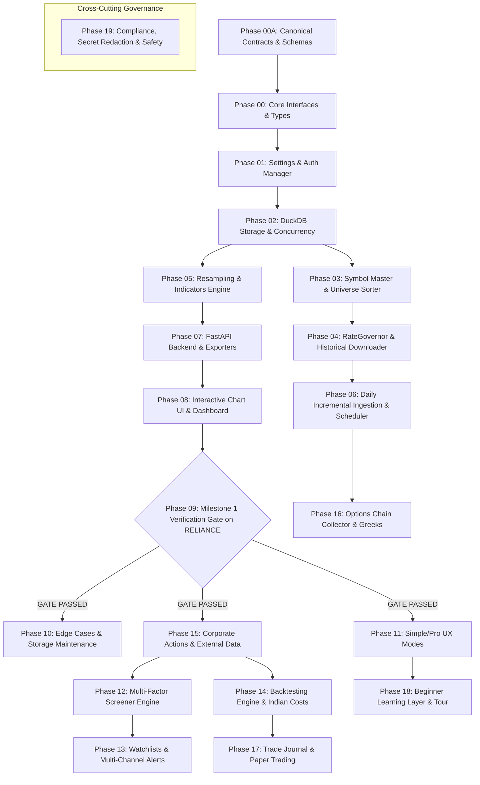

# Master Implementation Order & Phased Execution Blueprint

**Document Version**: 1.0.0  
**Target Audience**: Autonomous Coding Agents executing implementation in separate, isolated conversations.  
**Critical Instruction**: Implementing agents in subsequent conversations MUST **IGNORE** `/plan/_work/`. That directory is an internal orchestrator scratchpad. All authoritative specifications reside in `plan/00A_CONTRACTS_AND_CONVENTIONS.md` and `plan/00_MASTER_ARCHITECTURE.md` through `plan/19_COMPLIANCE_AND_SAFETY.md`.

---

## 1. Global Dependency Graph

---

## 2. Linear Implementation Stages & Hard Gates

### Stage 1: Core Foundation (Sequential Execution)
*These four phases establish the bedrock contracts, security, database storage, and instrument master. They must be executed strictly in order.*

1. **Phase 00A & 00**: Canonical Contracts, Interfaces, and Exception Hierarchy (`core/`). **ALREADY COMPLETED**
2. **Phase 01**: Environment Configuration, Pydantic Settings, Keyring Credential Vault, and Fyers API v3 Auth Manager (`config/`, `services/auth_service.py`). **ALREADY COMPLETED**
3. **Phase 02**: DuckDB Database Initialization, DDL Migrations, Single-Writer Mutex, and Read Cursors (`db/`).
4. **Phase 03**: NSE Symbol Master Parsing, Tier Classification (Nifty 100 + 150 + 250 = 500), and Checkpoint Seeding (`services/symbol_service.py`). **ALREADY COMPLETED**

---

### Stage 2: Ingestion & In-Database Analytics (Parallel Streams)
*Once Phase 03 is complete, the download pipeline and resampling analytics can proceed.*

5. **Phase 04**: Global RateGovernor (180 req/min target), Calendar Chunker, and Resumable Historical Downloader (`core/rate_governor.py`, `services/downloader_service.py`). **ALREADY COMPLETED**
6. **Phase 05**: In-Database Dynamic Resampling (with `TIMESTAMP '2000-01-01 03:45:00'` origin) and Technical Indicators Suite (`services/resampling_service.py`, `services/indicators/`).
7. **Phase 06**: Post-Market 15:45 IST Incremental Sync Scheduler, Trading Calendar, and Missed-Run Catchup (`services/scheduler_service.py`).
8. **Phase 07**: High-Performance FastAPI Backend, Cursor Pagination, and Streaming Exporters (`api/`, `services/export_service.py`).
9. **Phase 08**: TradingView Lightweight Charts Frontend, Simple/Pro Shell, and Re-Auth UI (`static/`).

---

### Stage 3: THE MANDATORY SCALING GATE (Zero-Tolerance Gate)

10. **Phase 09: Milestone 1 Benchmark on RELIANCE (`scripts/run_m1_benchmark.py`)**:
    - **CRITICAL ARCHITECTURAL GATE**: Full universe multi-stock downloading and advanced feature phases (12 through 18) **CANNOT PROCEED** until Phase 09 passes 100% of its 5 scaling gates:
      - [ ] Rate-Limit 30-min soak test: zero 429 errors and $\le 180\text{ req/min}$.
      - [ ] Timestamp convention test: verified 03:45 UTC market open.
      - [ ] Corporate action adjustment probe: verifies split factors.
      - [ ] DuckDB 100M row PK vs Staging benchmark: ensures write speed $\ge 25,000$ rows/s.
      - [ ] Empirical disk size gate: measured bytes/candle $\le 15$ bytes.

---

### Stage 4: Corporate Actions & Advanced Quant Engines
*After Phase 09 passes, Phase 15 (Corporate Actions Engine) must be implemented BEFORE Phase 14 (Backtesting) and Phase 12 (Screener) to guarantee price adjustment integrity.*

11. **Phase 10**: Quant Edge Cases, Automated Backup Restore Drill, and Maintenance Service (`services/maintenance_service.py`).
12. **Phase 11**: Simple/Pro UX Mode Controller and Translation Registry (`static/js/ux_mode_controller.js`).
13. **Phase 15**: Corporate Actions Ingestion, Cumulative Adjustment Factor Engine, and UDiFF Bhavcopy Ingestion (`services/corporate_actions_service.py`).
    - *Dependency Rule: Phase 15 MUST complete before Phase 14 so the backtester queries split-adjusted views (`candles_1d_adjusted`).*
14. **Phase 12**: Multi-Factor Screener Engine with Sub-2s Nifty 500 Performance (`services/screener_service.py`).
15. **Phase 13**: Watchlist Management, Real-Time Alerts, and Multi-Channel Notifiers (`services/alert_service.py`).
16. **Phase 14**: Institutional Backtesting Engine, Verified Indian Statutory Cost Model, Anti-Lookahead Enforcement, and Monte Carlo (`services/backtest_service.py`).
17. **Phase 16**: Options Chain Forward Collector, Black-Scholes Greeks Engine, Max Pain, and Payoff Curves (`services/options_service.py`).
18. **Phase 17**: Quantitative Trade Journal, $R$-Multiple Analytics, and Paper-Trading Simulator (`services/journal_service.py`).
19. **Phase 18**: Beginner Learning Layer, Three-Part Glossary, and Guided First-Scan Tutorial (`static/js/guided_tutorial.js`).

---

### Cross-Cutting Phase (Active Throughout All Phases)
20. **Phase 19**: Regulatory Compliance, SEBI Disclaimers, Structured Log Secret Redaction, and Fyers Data Licensing (`core/security.py`, `core/logging_config.py`).
    - *Applies to every phase: secrets never logged, no order execution allowed.*
21. **Phase 99**: Master Feature Traceability Matrix (`plan/99_FEATURE_TRACEABILITY.md`).

---

## 3. Parallel Execution Matrix for Development Teams

| Parallel Track | Eligible Phases | Dependencies Required | Notes |
|---|---|---|---|
| **Track A: Ingestion & Backend** | Phase 04 $\rightarrow$ Phase 06 $\rightarrow$ Phase 07 | Phase 01, 02, 03 | Focuses on data pipelines and server endpoints. |
| **Track B: Resampling & Indicators**| Phase 05 | Phase 02 | Can be developed in parallel with Track A. |
| **Track C: Frontend Chart Shell** | Phase 08 $\rightarrow$ Phase 11 $\rightarrow$ Phase 18 | Phase 07 (mock endpoints) | Frontend developers can build UI using mock fixtures. |
| **Track D: Quant Modeling** | Phase 15 $\rightarrow$ Phase 14 $\rightarrow$ Phase 17 | Phase 09 Gate Passed | Requires verified adjusted data from Phase 15. |
| **Track E: Derivatives & Options** | Phase 16 | Phase 06 (Scheduler) | Independent options snapshot collector. |
